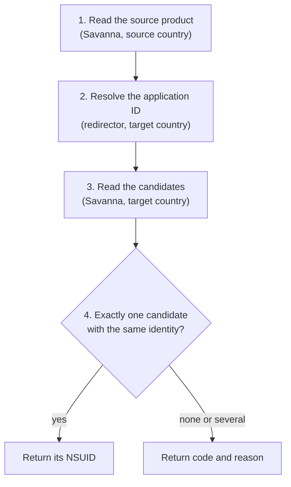

# How it works

[中文](how-it-works.zh-CN.md) · [README](../README.md) · [Reference](reference.md)

## Terms

| Term           | Meaning                                                                                                                                                                      |
| -------------- | ---------------------------------------------------------------------------------------------------------------------------------------------------------------------------- |
| NSUID          | 14-digit ID of a product in one country's eShop, e.g. `70010000095202`. The prefix gives the type: `7001` title, `7003` demo, `7005` DLC, `7007` bundle, `7009` consumable.  |
| Application ID | 16-hex ID of the software, e.g. `040078001ccf6000` (`applications.id`). Usually identical across countries.                                                                  |
| Platform       | `labelPlatform`: `HAC` is Nintendo Switch, `BEE` is Nintendo Switch 2.                                                                                                       |
| ROM rights     | `romRights.titleId`: the content IDs a purchase grants. A title grants its application ID; a Switch 2 Edition also grants an upgrade pack; a bundle grants all its contents. |
| Identity       | Type, platform and the complete set of ROM rights; for bundles, also every member. Products with the same identity are treated as the same product.                          |

## Nintendo endpoints

### Savanna

Savanna is the GraphQL API behind the web eShop (`ec.nintendo.com`):

```text
POST https://wb.lp1.savanna.srv.nintendo.net/graphql
```

Requests carry the web eShop's public client ID (`x-nintendo-savanna-client-id`)
and `Origin: https://ec.nintendo.com`. Each query specifies a country, a language
and a shop ID. An NSUID only resolves in the store it belongs to; a JP NSUID
returns nothing from the US store.

Fields used:

| Field                                 | Content                                        | Purpose                            |
| ------------------------------------- | ---------------------------------------------- | ---------------------------------- |
| `__typename`                          | Product type                                   | Selects the mapping steps          |
| `applications.id`                     | Application ID                                 | Input to the redirector            |
| `labelPlatform`                       | Platform                                       | Comparison                         |
| `romRights.titleId`                   | ROM rights                                     | Comparison; locating a DLC's title |
| `upgradeInfo`                         | Links between a title and its Switch 2 Edition | Locating the other edition         |
| `dlcItems`                            | A title's DLC and bundles, 100 per page        | DLC and bundle candidates          |
| `includedBundleItems`                 | Bundles containing the title                   | Bundle candidates                  |
| `itemsV2` (on a bundle)               | Bundle members                                 | Bundle comparison                  |
| `demoItems`, `targetApplicationItems` | A title's demos; a demo's title                | Demo mapping                       |

Savanna looks products up by NSUID only. It has no lookup by application ID, so
it cannot locate a product in another country on its own.

### The `/apps` redirector

```text
GET https://ec.nintendo.com/apps/{applicationId}/{country}
```

The response is a redirect whose `Location` contains the country's NSUID. For
Street Fighter 6 (`040078001ccf6000`):

| Country | `Location`                                                                              |
| ------- | --------------------------------------------------------------------------------------- |
| US      | `https://www.nintendo.com/pos-redirect/70010000095203?l=en&c=US`                        |
| GB      | `https://www.nintendo-europe.com/redirect/?nsuid=70010000095204&country=GB&language=en` |
| HK      | `/HK/zh/titles/70010000095206`                                                          |
| KR      | `https://www.nintendo.com/kr/games/switch2` (generic page, no NSUID)                    |

The library reads `Location` without following the redirect. This is the only
public way from an application ID to an NSUID. Limitations:

- Only application IDs are accepted; DLC IDs return 404.
- One application ID can cover several products, such as a title and its Switch 2
  Edition. The redirect returns one of them (`acdIndex` selects others), so it is
  a starting point rather than an answer.
- Some countries never redirect to a product page. See the
  [country list](reference.md#country-list).

## Mapping steps

All product types follow the same four steps; only step 3 differs.



Step 1 runs once. Steps 2–4 run for each target country, concurrently.

### Titles

1. Read the application ID, platform and ROM rights.
2. Resolve the application ID in the target country.
3. Read the resolved product and the editions linked to it through `upgradeInfo`.
4. Return the candidate with the same application ID, platform and ROM rights.

Step 3 is needed because a title and its Switch 2 Edition share an application
ID: the redirect may lead to the Switch version when the source is the Switch 2
Edition.

### DLC

A DLC has no application ID, and the redirector rejects DLC IDs, so the DLC is
resolved through its parent title.

1. Read the platform and ROM rights.
2. Derive the parent application ID from each ROM right: a DLC ID equals its
   title's application ID apart from the low 13 bits, e.g. `0100616025b6d002`
   belongs to `0100616025b6c000`. Resolve it in the target country.
3. Read the title's `dlcItems` page by page, plus DLC listed only in `upgradeInfo`.
4. Return the DLC with the same platform and ROM rights.

### Bundles

ROM rights alone do not identify a bundle: editions can share the same titles
and differ in extras. A bundle is compared on platform, ROM rights and every
member, including repeated members. Consumable members are compared by item ID
and publisher ID.

1. Read the bundle and its members.
2. Derive the parent titles from the members and resolve each.
3. Read the bundles listed under those titles and their linked editions.
4. Return the bundle with the same identity.

### Demos

A demo has neither an application ID nor ROM rights. Savanna does link demos and
titles in both directions (`targetApplicationItems`, `demoItems`), and the
library maps through that link.

1. Read the demo and its title.
2. Map the title as described under [Titles](#titles).
3. Read the target title's `demoItems`.
4. Return the demo on the same platform.

This evidence is weaker than ROM rights, so a result requires both the source
and the target title to list exactly one demo on that platform.

## Names

Names are never compared. They are localized, and editions often have
near-identical names, such as "Character Pass" and "Ultimate Pass". An incorrect
NSUID is worse than none.

## Unmapped results

An unmapped target carries a `code`; see [result codes](reference.md#result-codes).
Observed examples:

| Case                                                                         | `code`                                                     |
| ---------------------------------------------------------------------------- | ---------------------------------------------------------- |
| Monster Hunter Rise uses one application ID in JP/HK and another in US/EU    | `unresolved`                                               |
| JP DLC `70050000072882` and three sibling DLC have identical ROM rights      | `ambiguous`                                                |
| A bundle delisted in the target country is omitted from its title's listings | `no_candidates`, or `no_match` if other bundles are listed |
| KR: the redirector returns a generic page                                    | `unresolved`                                               |

A code does not prove that a product is unavailable, only that the public data
cannot identify a single product.

Search limits:

- At most 16 parent titles, and 40 pages of 100 items per title. A search that
  reaches a limit returns `incomplete` instead of a partial result.
- A parent title without a product page in the target country is skipped.
  Uniqueness is checked among the candidates found.
