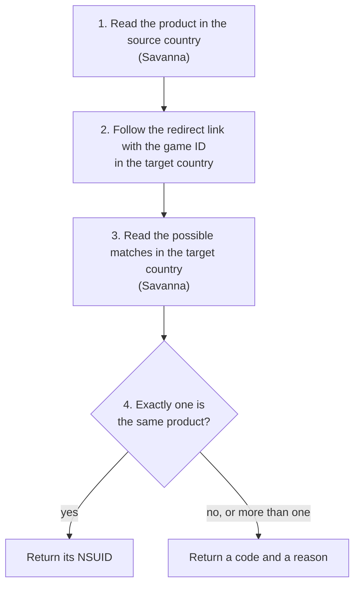

# How it works

[中文](how-it-works.zh-CN.md) · [README](../README.md) · [Reference](reference.md)

This page explains how the library finds the same product in another country:
the terms involved, the two Nintendo services it uses, and the steps for each
product type.

## Terms

| Term           | Meaning                                                                                                                                                                                                                        |
| -------------- | ------------------------------------------------------------------------------------------------------------------------------------------------------------------------------------------------------------------------------ |
| NSUID          | A product's number in one country's eShop: 14 digits, such as `70010000095202`. The first four digits give the type: `7001` game, `7003` demo, `7005` DLC, `7007` bundle, `7009` consumable.                                   |
| Game ID        | The ID of the game software itself: 16 hexadecimal characters, such as `040078001ccf6000`. It is normally the same in every country. Nintendo's data calls it the application ID.                                              |
| Platform       | Which console a product is for: `HAC` is Nintendo Switch, `BEE` is Nintendo Switch 2.                                                                                                                                          |
| Content rights | The list of content IDs a purchase unlocks. A game unlocks its own game ID; a Switch 2 Edition also unlocks an upgrade pack; a bundle unlocks everything inside it. Two products with the same rights unlock the same content. |
| Same product   | In this library: the same type, platform and complete content rights. For a bundle, also the same members.                                                                                                                     |

## The two Nintendo services

### 1. Savanna: product data

Savanna is the data service behind Nintendo's web eShop (`ec.nintendo.com`). It
answers [GraphQL](https://graphql.org/) queries sent by `POST` to:

```text
https://wb.lp1.savanna.srv.nintendo.net/graphql
```

The library sends the same identifying headers as the web eShop: the store's public
client ID and its `Origin`. Every query names a country, a language and a shop.
A product can only be read in the store it belongs to: asking the US store for a
Japanese NSUID returns nothing.

This is what the library reads, and why:

| Data read                                | What it is                                     | Used for                                  |
| ---------------------------------------- | ---------------------------------------------- | ----------------------------------------- |
| Product type                             | Game, DLC, bundle, demo…                       | Choosing the steps                        |
| `applications.id`                        | Game ID                                        | Following the redirect link               |
| `labelPlatform`                          | Platform                                       | Comparison                                |
| `romRights.titleId`                      | Content rights                                 | Comparison; finding the game behind a DLC |
| `upgradeInfo`                            | Links between a game and its Switch 2 Edition  | Finding the other edition                 |
| `dlcItems`                               | A game's DLC and bundles, 100 per page         | Candidates for DLC and bundles            |
| `includedBundleItems`                    | Bundles that contain the game                  | Candidates for bundles                    |
| Bundle members (`itemsV2`)               | The games, DLC and consumables inside a bundle | Comparison of bundles                     |
| `demoItems` and `targetApplicationItems` | A game's demos, and a demo's game              | Mapping demos                             |

Savanna can only look products up by NSUID. It cannot answer "which product has
this game ID", so it cannot find a product in another country by itself.

### 2. The redirect link: game ID to NSUID

Nintendo's web eShop has a link that opens a game's page in a given country:

```text
https://ec.nintendo.com/apps/{game ID}/{country}
```

It does not return data. It answers with a redirect whose address contains that
country's NSUID. For Street Fighter 6 (`040078001ccf6000`):

| Country | Redirect address                                                                        |
| ------- | --------------------------------------------------------------------------------------- |
| US      | `https://www.nintendo.com/pos-redirect/70010000095203?l=en&c=US`                        |
| GB      | `https://www.nintendo-europe.com/redirect/?nsuid=70010000095204&country=GB&language=en` |
| HK      | `/HK/zh/titles/70010000095206`                                                          |
| KR      | `https://www.nintendo.com/kr/games/switch2`, a general page with no NSUID               |

The library reads the NSUID from the address and does not follow the redirect.
This link is the only public way from a game ID to an NSUID. It has limits:

- It only accepts game IDs. A DLC's content ID returns "not found".
- A game ID can belong to several products, such as a game and its Switch 2
  Edition. The link returns one of them, so its answer is only a starting point.
- Some countries never redirect to a product page. See the
  [README](../README.md#countries).

## The steps

Every mapping has the same four steps. Only step 3, which products to consider,
differs by product type.



Step 1 happens once. Steps 2 to 4 run for every target country, and the target
countries run at the same time.

### Games

1. Read the game: its game ID, platform and content rights.
2. Follow the redirect link with the game ID in the target country.
3. Read the product it leads to, together with any edition linked to it, such
   as the Switch version of a Switch 2 Edition.
4. Return the one that has the same game ID, platform and content rights.

Step 3 matters because a game and its Switch 2 Edition share a game ID. The redirect
link may lead to the Switch version while the source is the Switch 2 Edition; the
comparison picks the right one, or returns nothing.

### DLC

A DLC has no game ID of its own, and the redirect link does not accept DLC IDs.
So the library goes through the DLC's game:

1. Read the DLC: its platform and content rights.
2. Work out the game ID from the DLC's content ID. Nintendo numbers a game's DLC
   just after the game itself, so the game ID is the DLC ID with its last part
   cleared: `0100616025b6d002` belongs to `0100616025b6c000`. Then follow the
   redirect link with that game ID.
3. Read the target game's DLC list, page by page, including DLC listed only as
   upgrade packs.
4. Return the one DLC with the same platform and complete content rights.

### Bundles

A bundle has no game ID either, and its content rights alone are not enough:
different editions can contain the same games but different extras. So a bundle
is compared on its platform, its content rights and every member, including how
many times a member appears. A consumable member, such as in-game currency, is
compared by its item ID and publisher.

1. Read the bundle and all its members.
2. Work out the games behind the members, and follow the redirect link for each.
3. Read every bundle listed under those games, and under their linked editions.
4. Return the one bundle that matches completely.

### Demos

A demo has no game ID and no content rights. Nintendo's data does say which game a
demo belongs to, and which demos a game has. The library uses that link:

1. Read the demo and its game.
2. Map the game as described under [Games](#games).
3. Read the demos listed under the target game.
4. Return the target game's demo on the same platform.

This is weaker evidence than content rights, so it is only accepted when both the
source game and the target game list exactly one demo on that platform.

## Why names are never compared

Names are translated, and different editions often have nearly identical names,
such as a "Character Pass" and an "Ultimate Pass". A wrong NSUID is worse than no
NSUID, so a result is only returned when the data identifies exactly one product.

## When there is no result

The result carries a `code` explaining why. The full list is in the
[reference](reference.md#result-codes). Common real cases:

| Case                                                                                                    | Code                                                           |
| ------------------------------------------------------------------------------------------------------- | -------------------------------------------------------------- |
| Monster Hunter Rise uses one game ID in Japan and Hong Kong and another in the US and Europe            | `unresolved`                                                   |
| Japanese DLC `70050000072882` and three other DLC packs for the same game have identical content rights | `ambiguous`                                                    |
| A bundle delisted in the target country is left out of its game's lists                                 | `no_candidates`, or `no_match` if the game lists other bundles |
| Korea: the redirect link leads to a general page                                                        | `unresolved`                                                   |

None of these prove that the product is missing in the target country. They mean
the public data is not enough to name one product with certainty.

Two more rules keep results safe:

- **Searches are limited.** The library reads at most 16 games and 40 pages of
  100 items per game. If a search stops at a limit, it returns `incomplete` rather
  than a match from a partial list.
- **A match is unique among the products found.** When one of a DLC's or bundle's
  games has no page in the target country, that game is skipped. The match must
  still be complete and the only one among the products that were found.
