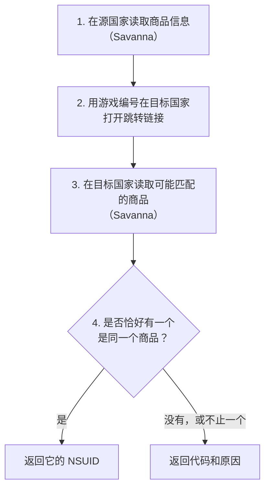

# 原理说明

[English](how-it-works.md) · [README](../README.zh-CN.md) · [参考文档](reference.zh-CN.md)

本文说明本项目如何在另一个国家找到同一个商品：涉及的名词、用到的两个任天堂服务，以及每种商品的映射步骤。

## 名词

| 名词       | 含义                                                                                                                                                      |
| ---------- | --------------------------------------------------------------------------------------------------------------------------------------------------------- |
| NSUID      | 商品在某个国家 eShop 里的编号，14 位数字，例如 `70010000095202`。前四位表示类型：`7001` 游戏本体，`7003` 体验版，`7005` DLC，`7007` 合集，`7009` 消耗品。 |
| 游戏编号   | 游戏软件本身的编号，16 位十六进制字符，例如 `040078001ccf6000`。通常在各国都一样。任天堂的数据里叫 application ID。                                       |
| 平台       | 商品对应的主机：`HAC` 是 Nintendo Switch，`BEE` 是 Nintendo Switch 2。                                                                                    |
| 内容权益   | 购买后解锁的内容编号列表。游戏本体解锁自己的游戏编号；Switch 2 版还会多解锁一个升级包；合集解锁其中的全部内容。权益相同的两个商品，解锁的内容也相同。     |
| 同一个商品 | 在本项目里指：类型、平台和完整的内容权益都相同。合集还要求成员也相同。                                                                                    |

## 两个任天堂服务

### 1. Savanna：商品数据

Savanna 是任天堂网页版 eShop（`ec.nintendo.com`）背后的数据服务。它接受通过 `POST` 发送的 [GraphQL](https://graphql.org/) 查询，地址是：

```text
https://wb.lp1.savanna.srv.nintendo.net/graphql
```

本项目发送与网页版 eShop 相同的标识请求头：商店公开的 client ID 和它的 `Origin`。每次查询都要指定国家、语言和商店。商品只能在它所属的商店里查到：拿日本的 NSUID 去查美国商店，什么都查不到。

本项目从中读取的数据和用途：

| 读取的数据                              | 是什么                                 | 用途                      |
| --------------------------------------- | -------------------------------------- | ------------------------- |
| 商品类型                                | 本体、DLC、合集、体验版等              | 决定走哪套步骤            |
| `applications.id`                       | 游戏编号                               | 用于跳转链接              |
| `labelPlatform`                         | 平台                                   | 比较                      |
| `romRights.titleId`                     | 内容权益                               | 比较；找到 DLC 所属的游戏 |
| `upgradeInfo`                           | 游戏与其 Switch 2 版之间的关联         | 找到另一个版本            |
| `dlcItems`                              | 游戏名下的 DLC 和合集，每页 100 条     | DLC 和合集的候选          |
| `includedBundleItems`                   | 包含该游戏的合集                       | 合集的候选                |
| 合集成员（`itemsV2`）                   | 合集里的游戏、DLC 和消耗品             | 比较合集                  |
| `demoItems` 和 `targetApplicationItems` | 游戏名下的体验版，以及体验版所属的游戏 | 映射体验版                |

Savanna 只能按 NSUID 查商品，不能回答"哪个商品的游戏编号是这个"，所以单靠它找不到另一个国家的商品。

### 2. 跳转链接：从游戏编号到 NSUID

任天堂网页版 eShop 有一个链接，可以打开某款游戏在指定国家的商品页：

```text
https://ec.nintendo.com/apps/{游戏编号}/{国家}
```

它不返回数据，而是返回一个跳转，跳转地址里带着该国的 NSUID。以《街头霸王 6》（`040078001ccf6000`）为例：

| 国家 | 跳转地址                                                                                |
| ---- | --------------------------------------------------------------------------------------- |
| US   | `https://www.nintendo.com/pos-redirect/70010000095203?l=en&c=US`                        |
| GB   | `https://www.nintendo-europe.com/redirect/?nsuid=70010000095204&country=GB&language=en` |
| HK   | `/HK/zh/titles/70010000095206`                                                          |
| KR   | `https://www.nintendo.com/kr/games/switch2`，一个通用页面，没有 NSUID                   |

本项目只从地址里读取 NSUID，不会真的跳过去。这个链接是从游戏编号到 NSUID 的唯一公开途径，但它有局限：

- 只接受游戏编号。用 DLC 的内容编号会返回"找不到"。
- 一个游戏编号可能对应多个商品，例如游戏本体和它的 Switch 2 版。链接只返回其中一个，所以它的结果只能作为起点。
- 有些国家永远不会跳到商品页，见 [README](../README.zh-CN.md#支持的国家)。

## 映射步骤

每次映射都是同样的四步，只有第 3 步"考虑哪些商品"因商品类型而不同。



第 1 步只做一次。第 2 到 4 步对每个目标国家各做一遍，各目标国家同时进行。

### 游戏本体

1. 读取游戏的游戏编号、平台和内容权益。
2. 用游戏编号在目标国家打开跳转链接。
3. 读取跳转到的商品，以及与它关联的其他版本，例如 Switch 2 版对应的 Switch 版。
4. 返回游戏编号、平台和内容权益都相同的那一个。

第 3 步很重要，因为游戏本体和它的 Switch 2 版共用同一个游戏编号。跳转链接可能指向 Switch 版，而源商品是 Switch 2 版；比较这一步会选出正确的那个，或者不返回结果。

### DLC

DLC 没有自己的游戏编号，跳转链接也不接受 DLC 编号，所以要通过 DLC 所属的游戏：

1. 读取 DLC 的平台和内容权益。
2. 从 DLC 的内容编号推算出游戏编号。任天堂把游戏的 DLC 编在游戏本身之后，所以把 DLC 编号的末尾部分清零就得到游戏编号：`0100616025b6d002` 属于 `0100616025b6c000`。然后用这个游戏编号打开跳转链接。
3. 逐页读取目标游戏名下的 DLC 列表，包括只以升级包形式列出的 DLC。
4. 返回平台和完整内容权益都相同的那一个 DLC。

### 合集

合集也没有游戏编号，而且只看内容权益还不够：不同版本可能包含相同的游戏，但附赠内容不同。所以合集要比较平台、内容权益和每一个成员，包括同一个成员出现几次。消耗品成员（例如游戏内货币）按物品编号和发行商比较。

1. 读取合集及其全部成员。
2. 推算出成员所属的游戏，分别打开跳转链接。
3. 读取这些游戏名下列出的全部合集，以及它们关联版本名下的合集。
4. 返回完全一致的那一个合集。

### 体验版

体验版既没有游戏编号，也没有内容权益。不过任天堂的数据里记录了体验版属于哪款游戏，以及每款游戏有哪些体验版。本项目利用的就是这层关系：

1. 读取体验版和它所属的游戏。
2. 按[游戏本体](#游戏本体)的方法映射这款游戏。
3. 读取目标游戏名下的体验版。
4. 返回目标游戏在同一平台上的体验版。

这比比较内容权益的依据弱，所以只有源游戏和目标游戏在该平台上都恰好只列出一个体验版时，才接受结果。

## 为什么从不比较名称

名称会被翻译，而且不同版本的名称常常几乎一样，例如"角色通行证"和"终极通行证"。返回错误的 NSUID 比不返回更糟，所以只有数据能确定唯一一个商品时才返回结果。

## 没有结果的情况

结果里会带一个 `code` 说明原因，完整列表见[参考文档](reference.zh-CN.md#结果代码)。常见的真实例子：

| 情况                                                                | 代码                                                       |
| ------------------------------------------------------------------- | ---------------------------------------------------------- |
| 《怪物猎人 崛起》在日本和香港用一个游戏编号，在美国和欧洲用另一个   | `unresolved`                                               |
| 日本 DLC `70050000072882` 和同一游戏的另外三个 DLC 内容权益完全相同 | `ambiguous`                                                |
| 在目标国家已下架的合集，不会出现在游戏名下的列表里                  | `no_candidates`；如果游戏名下还有其他合集，则是 `no_match` |
| 韩国：跳转链接只跳到通用页面                                        | `unresolved`                                               |

这些都不能证明目标国家没有这个商品，只说明公开数据不足以确定唯一一个商品。

另外还有两条规则保证结果可靠：

- **查找范围有上限**。最多读取 16 款游戏，每款游戏最多 40 页、每页 100 条。如果查找在上限处中断，返回 `incomplete`，不会从不完整的列表里给出结果。
- **只在找到的商品里保证唯一**。DLC 或合集所属的某款游戏如果在目标国家没有商品页，就跳过它。结果仍必须完全一致，并且在找到的商品中是唯一的一个。
