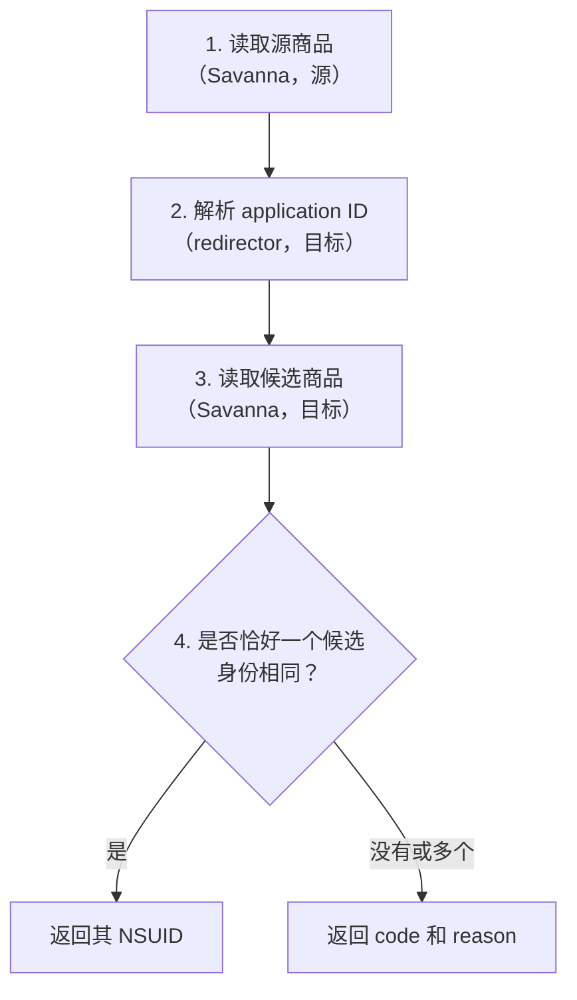

# 原理说明

[English](how-it-works.md) · [README](../README.zh-CN.md) · [参考文档](reference.zh-CN.md)

## 术语

| 术语           | 含义                                                                                                                                                        |
| -------------- | ----------------------------------------------------------------------------------------------------------------------------------------------------------- |
| NSUID          | 商品在某个国家或地区的 eShop 中的 14 位编号，例如 `70010000095202`。前缀表示类型：`7001` title，`7003` demo，`7005` DLC，`7007` bundle，`7009` consumable。 |
| Application ID | 软件本身的 16 位十六进制编号，例如 `040078001ccf6000`（`applications.id`）。通常在各国相同。                                                                |
| Platform       | `labelPlatform`：`HAC` 为 Nintendo Switch，`BEE` 为 Nintendo Switch 2。                                                                                     |
| ROM rights     | `romRights.titleId`：购买后获得的内容编号。Title 包含自身的 application ID；Switch 2 Edition 另含升级包；bundle 包含其全部内容。                            |
| 身份           | 类型、platform 与完整的 ROM rights；bundle 还包括全部成员。身份相同的商品视为同一商品。                                                                     |

## 任天堂接口

### Savanna

Savanna 是网页版 eShop（`ec.nintendo.com`）背后的 GraphQL API：

```text
POST https://wb.lp1.savanna.srv.nintendo.net/graphql
```

请求需携带网页版 eShop 的公开 client ID（`x-nintendo-savanna-client-id`）和 `Origin: https://ec.nintendo.com`。每个查询都要指定国家或地区代码、语言和 shop ID。NSUID 只能在其所属的商店中查到，例如在 US 商店查询 JP 的 NSUID 不会返回结果。

使用的字段：

| 字段                                  | 内容                                   | 用途                        |
| ------------------------------------- | -------------------------------------- | --------------------------- |
| `__typename`                          | 商品类型                               | 决定映射步骤                |
| `applications.id`                     | Application ID                         | Redirector 的输入           |
| `labelPlatform`                       | Platform                               | 比较                        |
| `romRights.titleId`                   | ROM rights                             | 比较；定位 DLC 所属的 title |
| `upgradeInfo`                         | Title 与其 Switch 2 Edition 之间的关联 | 定位另一个版本              |
| `dlcItems`                            | Title 下的 DLC 和 bundle，每页 100 条  | DLC 与 bundle 的候选        |
| `includedBundleItems`                 | 包含该 title 的 bundle                 | Bundle 的候选               |
| `itemsV2`（bundle 上）                | Bundle 成员                            | Bundle 比较                 |
| `demoItems`、`targetApplicationItems` | Title 的 demo；demo 所属的 title       | Demo 映射                   |

Savanna 只支持按 NSUID 查询商品，不支持按 application ID 查询，因此无法单独定位其他商店的商品。

### `/apps` redirector

```text
GET https://ec.nintendo.com/apps/{applicationId}/{country}
```

响应是一个重定向，`Location` 中包含该国家或地区的 NSUID。以《街头霸王 6》（`040078001ccf6000`）为例：

| 代码 | `Location`                                                                              |
| ---- | --------------------------------------------------------------------------------------- |
| US   | `https://www.nintendo.com/pos-redirect/70010000095203?l=en&c=US`                        |
| GB   | `https://www.nintendo-europe.com/redirect/?nsuid=70010000095204&country=GB&language=en` |
| HK   | `/HK/zh/titles/70010000095206`                                                          |
| KR   | `https://www.nintendo.com/kr/games/switch2`（通用页面，不含 NSUID）                     |

本项目只读取 `Location`，不跟随重定向。这是从 application ID 得到 NSUID 的唯一公开途径。限制：

- 只接受 application ID；DLC ID 返回 404。
- 一个 application ID 可能对应多个商品，例如 title 及其 Switch 2 Edition。重定向只返回其中一个（`acdIndex` 可选择其他），因此只能作为起点，不能直接作为结果。
- 部分国家和地区不会重定向到商品页，见[完整列表](reference.zh-CN.md#国家和地区)。

## 映射步骤

所有商品类型都按相同的四步进行，只有第 3 步不同。



第 1 步只执行一次；第 2–4 步对每个目标各执行一次，并发进行。

### Title

1. 读取 application ID、platform 和 ROM rights。
2. 在目标商店中解析 application ID。
3. 读取解析到的商品，以及通过 `upgradeInfo` 关联的其他版本。
4. 返回 application ID、platform 和 ROM rights 都相同的候选。

需要第 3 步，是因为 title 与其 Switch 2 Edition 共用 application ID：源商品是 Switch 2 Edition 时，重定向可能指向 Switch 版。

### DLC

DLC 没有 application ID，redirector 也不接受 DLC ID，因此通过其所属的 title 解析。

1. 读取 platform 和 ROM rights。
2. 从每个 ROM right 推导所属 title 的 application ID：DLC ID 与其 title 的 application ID 仅低 13 位不同，例如 `0100616025b6d002` 属于 `0100616025b6c000`。在目标商店中解析该 application ID。
3. 分页读取 title 的 `dlcItems`，以及仅在 `upgradeInfo` 中列出的 DLC。
4. 返回 platform 和 ROM rights 都相同的 DLC。

### Bundle

仅凭 ROM rights 无法识别 bundle：不同版本可能包含相同的 title，只在附加内容上不同。因此 bundle 比较 platform、ROM rights 和全部成员，包括重复成员。Consumable 成员按 item ID 和 publisher ID 比较。

1. 读取 bundle 及其成员。
2. 从成员推导所属 title，并分别解析。
3. 读取这些 title 及其关联版本下列出的 bundle。
4. 返回身份相同的 bundle。

### Demo

Demo 既没有 application ID，也没有 ROM rights。Savanna 提供了 demo 与 title 之间的双向关联（`targetApplicationItems`、`demoItems`），本项目据此映射。

1. 读取 demo 及其所属 title。
2. 按 [Title](#title) 的步骤映射该 title。
3. 读取目标 title 的 `demoItems`。
4. 返回同一 platform 上的 demo。

这类依据弱于 ROM rights，因此要求源 title 和目标 title 在该 platform 上都只有一个 demo，且源 title 的这个 demo 必须就是源 demo 本身。源 title 没有列出 demo，或只列出其他 demo 时，返回 `insufficient_identity`。

## 名称

不比较名称。名称会本地化，而且不同版本的名称常常几乎相同，例如 "Character Pass" 与 "Ultimate Pass"。错误的 NSUID 比没有结果更糟。

## 未映射的结果

未映射的目标带有 `code`，见[结果代码](reference.zh-CN.md#结果代码)。实际案例：

| 情况                                                                | `code`                                                         |
| ------------------------------------------------------------------- | -------------------------------------------------------------- |
| 《怪物猎人 崛起》在 JP/HK 与 US/EU 使用不同的 application ID        | `unresolved`                                                   |
| JP DLC `70050000072882` 与另外三个同系列 DLC 的 ROM rights 完全相同 | `ambiguous`                                                    |
| 在目标商店中已下架的 bundle 不出现在 title 的列表中                 | `no_candidates`；若该 title 下还有其他 bundle，则为 `no_match` |
| KR：redirector 返回通用页面                                         | `unresolved`                                                   |

`code` 不能证明商品在目标商店中没有销售，只表示公开数据不足以确定唯一的商品。

查找限制：

- 最多 16 个所属 title，每个 title 最多 40 页、每页 100 条。达到上限时返回 `incomplete`，不返回不完整的结果。
- 在目标商店中没有商品页的所属 title 会被跳过，唯一性只在已找到的候选中检查。
